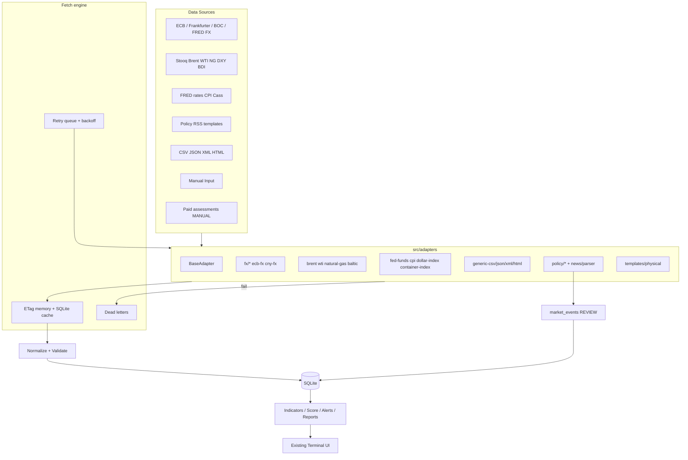

# Commodity Intelligence Platform — Architecture

This document describes the **data-source-first** architecture for the Commodity Intelligence Platform (CIT). Stable UI modules were not redesigned in the public-adapters phase.

## 1. Pipeline

```
Data Source → Adapter → Normalize → Validate → SQLite
  → Indicators → Market Score / Alerts / Analysis → Reports → UI
```



## 2. Adapter classification

### REAL
| id | Upstream |
|----|----------|
| `ecb-official-fx`, `ecb-fx`, `cny-fx`, `public-fx-json` | Frankfurter / ECB JSON |
| `bank-of-canada-fx` | Bank of Canada Valet JSON |
| `fed-fx` | FRED DEXCHUS CSV |
| `brent`, `wti` | Stooq public CSV |
| `baltic-index` | Stooq public CSV |
| `natural-gas` | Stooq NG continuous |
| `dollar-index` | Stooq DX continuous |
| `fed-funds` | FRED DFF |
| `cpi-inflation` | FRED CPIAUCSL |
| `container-index` | FRED Cass Freight (proxy, not SCFI) |

### PUBLIC
| id | Notes |
|----|-------|
| `generic-csv`, `generic-json`, `generic-xml`, `generic-html` | Mapping via Settings |
| `public-html-table`, `public-rss` | Configured permissive pages/feeds |
| `china-policy` … `iran-policy`, `rss` | Country RSS → REVIEW |

### TEMPLATE
Physical sulphur surveys, PDF/Excel stubs, unconfigured policy rows.

### MANUAL
`manual-required` + all `MANUAL_REQUIRED` rows (Argus / ICIS / Mysteel never automated).

## 3. Scheduler defaults

| Family | Interval | Priority | Max retries | Backoff |
|--------|----------|----------|-------------|---------|
| ECB / CNY FX | 24h | critical/high | 3 | 60m |
| BOC / Fed FX | 24h | high | 3 | 60m |
| Brent / WTI / NG / DXY | 6h | high | 3 | 45m |
| Baltic | 6–12h | high | 3 | 45m |
| Fed funds / CPI / Cass | 24h | normal | 3 | 60–120m |
| Generic CSV/JSON/XML | 6h | normal | 3 | 30m |
| HTML table | 1h | normal | 2 | 60m |
| Policy RSS | 30–180m | normal | 2 | 60m |

Due selection uses adapter `schedule.refreshIntervalMinutes` when registered. Each tick also drains `adapter_retry_queue` (exponential backoff → dead letter).

## 4. Migrations

| id | Purpose |
|----|---------|
| `001_init` | Core schema |
| `002_provenance_and_fetch_metrics` | confidence, retrievalMethod, validationResult, latencyMs |
| `003_license_cache_retry` | `observations.license`, `fetch_cache`, `adapter_retry_queue`, `adapter_dead_letters` |

Seed version: `2026-08-10.public-adapters.2` (macro + natural-gas + china-policy + REAL FX ids).

## 5. Folder structure

```
src/adapters/
  base-adapter.ts
  index.ts / registry.ts / types.ts
  shared/   frankfurter, stooq-csv, fred-csv, boc-valet, cached-fetch, resolve-targets
  fx/  macro/  generic/  policy/  news/
  ecb-fx/ cny-fx/ brent/ wti/ baltic-index/
  templates/physical.ts

src/lib/data-sources/
  index.ts            # runDueSources
  fetch-engine.ts     # retry + DLQ
  base-source.ts      # contract + runAdapter
  public-web/         # html-table + rss helpers

src/config/commodities/
  sulphur.ts  crude-oil.ts  natural-gas.ts  macro.ts
```

## 6. Provenance (every observation)

`source` · `publisher` · `url` · `retrievalMethod` · `confidence` · `validation` · `timestamp` · `license`

## 7. Extension guide

### Add a public adapter
1. Extend `BaseAdapter` under `src/adapters/<family>/`
2. Register in `src/adapters/index.ts` with `accessLabel` + `schedule`
3. Point `SourceConfig.adapterId` with `automation: "AUTOMATED"`
4. Resolve targets via DB linkage — do not hardcode commodities except as fallbacks

### Add a policy feed
1. Set a robots-allowed RSS/Atom URL on the source
2. Enable the source
3. Events land as `status: REVIEW` with keyword/importance metadata in the summary

### Paid / prohibited
Leave as `MANUAL_REQUIRED`. Never scrape ICIS, Argus, Mysteel, or auth-walled sites.

## Commodity Intelligence Engine (CIE)

See `docs/CIE.md` and `src/intelligence/`.

```
Observation → Indicators → Drivers → Risk → Scenario → Forecast → Research → Reports
```

Independent engines under `src/intelligence/`. `report.ts` calls `runIntelligence()` and maps output into existing `AnalysisOutlook` — no UI redesign, no adapter/scheduler/migration changes.
