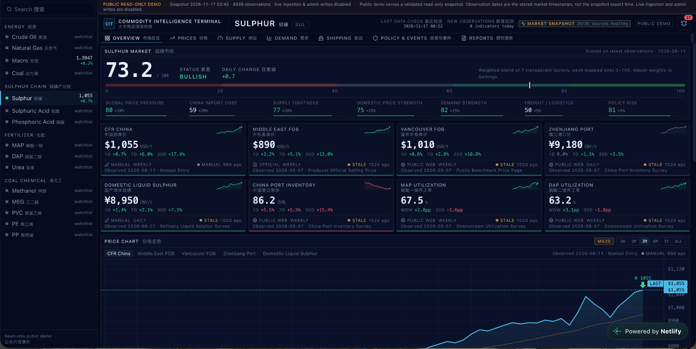
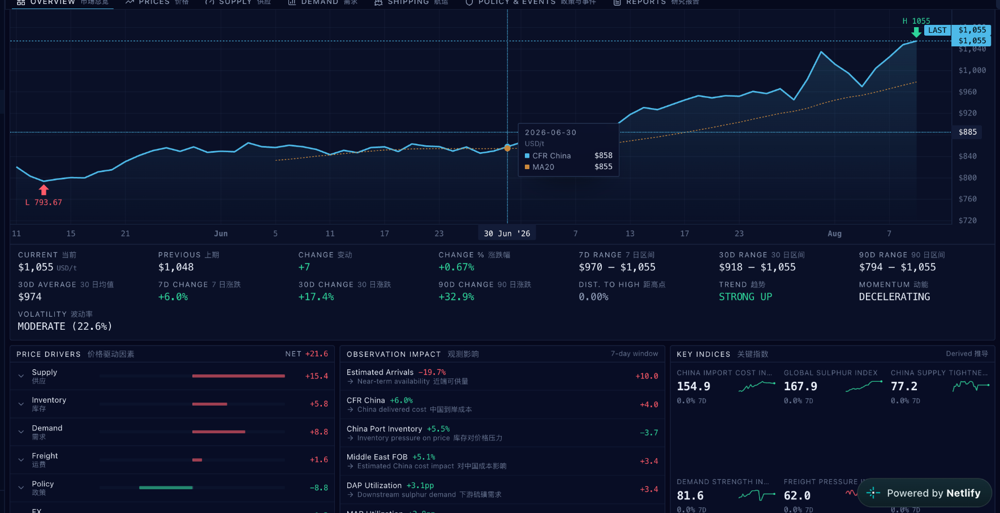
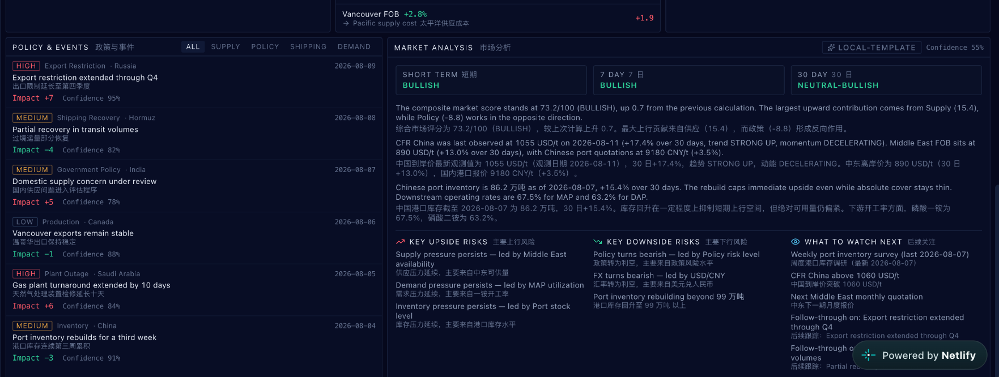
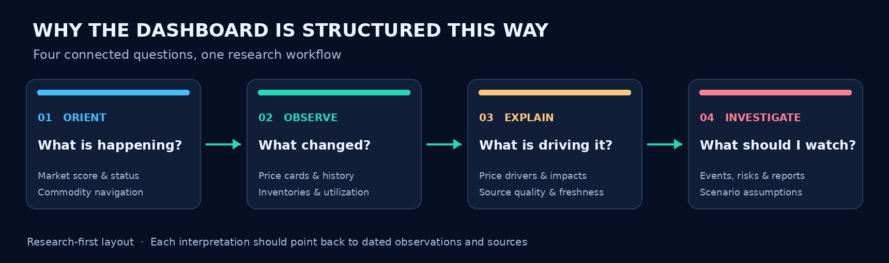
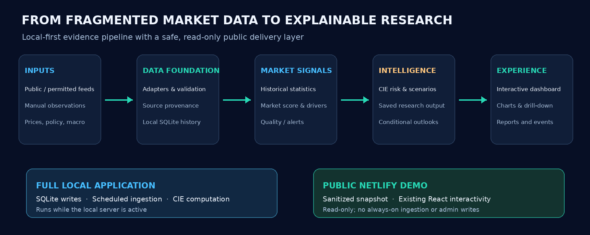

<div align="center">

# Commodity Intelligence Platform (CIT)

**A research-first terminal for interconnected commodity markets.**

From fragmented market observations to traceable indicators, explainable drivers, and structured market research.

[](https://commodity-intelligence-cit.netlify.app/)

[](https://nextjs.org/)


**[Launch the public interactive dashboard](https://commodity-intelligence-cit.netlify.app/)** · [Product tour](#01--a-visual-tour-of-the-terminal) · [Design thinking](#02--why-the-terminal-looks-like-this) · [Architecture](#04--how-the-platform-works) · [Local setup](#06--run-the-full-system-locally)

</div>

---

## Built to explain markets, not just display prices

CIT began with a concrete question in **sulphur trading and research**: how do international sulphur quotations, China's landed import costs, port stocks, refinery supply, downstream fertilizer activity, freight, FX and policy changes interact to affect the domestic market?

Those signals come from different publishers and arrive at different frequencies, units and levels of reliability. CIT brings them into a single research workflow that asks **what changed, what might be driving it, how reliable the evidence is, and what should be watched next**. The terminal uses a configurable foundation that can be extended to energy, fertilizer and petrochemical markets.

> **About the public demo:** This is the actual interactive Next.js application running in **read-only snapshot mode**, not a mockup. The hosted demo does not continuously ingest data or permit database/admin writes. **Some displayed sulphur history and event examples are seeded or synthetic, while other observations are manual or stale.** Do not treat the numbers, dated events, scores or outlooks in the screenshots as verified current market assessments or trading advice.

## 01 — A visual tour of the terminal

### A. One screen to orient the research

The opening view keeps the **commodity navigator, market-state score, regional price benchmarks, port inventories, downstream utilization, and price trend** together. Instead of making the user jump between many disconnected sources, it puts the market's competing signals in one field of view.



*Actual CIT public-demo screenshot · Overview. The screen shows a dated data snapshot; market figures and policy/event examples are not guaranteed real or current.*

**Design choice:** a high-level directional score provides a quick orientation, but the seven factor components and source labels remain visible so the user can inspect what drives the score. A score is **not** a calibrated probability of a future price move.

### B. Follow the price, then inspect the drivers

A movement in a quoted price does not explain itself. The history chart adds context through date navigation, moving averages, ranges, momentum and volatility. Below it, the **Price Drivers**, **Observation Impact** and **Key Indices** panels expose competing signals across supply, inventory, demand, freight, policy and FX.



*Actual CIT screenshot · Historical chart and driver analysis, cropped from the provided live interface for legibility.*

**Why it matters:** a rise in Middle East FOB may push up import costs, while growing Chinese port stocks may put pressure on domestic prices. The system is designed to present these signals together rather than mistake a single benchmark move for a complete explanation.

### C. Move from signals to a research narrative

The interpretation layer joins **Policy & Events** with **Market Analysis**, directional outlooks, upside and downside risks, and a focused **What to Watch Next** list. This connects the measured indicators to questions that an analyst can investigate further.



*Actual CIT screenshot · Events and market interpretation. Event examples and confidence labels are part of the historical/illustrative demo data, not independently verified current announcements or calibrated probabilities.*

**Design choice:** event tracking, driver reasoning and research commentary are separate from the observations that support them. An event in review, a low-quality indicator or a stale manual quote should not be treated as an established causal explanation.

## 02 — Why the terminal looks like this

The dashboard is arranged around **four research questions**, not around isolated interface widgets:



- **Orient:** What is the current model-implied market state?
- **Observe:** Which benchmarks or underlying indicators changed, and when?
- **Explain:** Which conflicting drivers and source-quality signals might account for those changes?
- **Investigate:** Which scenarios, risks, events and evidence should be monitored next?

The left sidebar groups related commodities; top-level tabs let the user drill into **Prices, Supply, Demand, Shipping, Policy & Events, and Reports**, while the shared layout preserves context across those investigations.

## 03 — From observations to market interpretation

The market score and CIE (Commodity Intelligence Engine) form **different layers**. Weighted indicators organize today's signals; driver and risk modules interpret them; scenarios and reports describe conditional possibilities. The objective is inspectable reasoning—not a black-box price forecast.

| Analytical layer | Responsibility |
| --- | --- |
| **Market observations** | Dated price, inventory, utilization, FX, freight and policy records, each with source metadata. |
| **Indicators & market score** | Changes, trends, normalized factor values and a transparent weighted composite. |
| **Driver and risk engines** | Bullish/bearish pressures, competing evidence, uncertainty and market risks. |
| **Scenario / forecast modules** | Conditional 7-, 30- and 90-day direction labels; not trained or calibrated price predictions. |
| **Research & alerts** | Structured market notes, what-changed context and rule-driven monitoring. |

**Market logic example (conceptual, not a verified price forecast):** Middle East FOB ↑ → potential China import-cost pressure ↑; meanwhile China port inventory ↑ → potential domestic stock pressure ↑. The final interpretation depends on actual observations, source quality and the relative strength of each factor.

## 04 — How the platform works



The application was built **data-source first**: adapters normalize permitted public data and manual observations, then validation and provenance layers create structured historical records. The local analytics stack computes indicators, market scores, drivers and reports. A sanitized snapshot provides the **same interactive product interface** to public visitors without exposing maintenance functions.

<details>
<summary><strong>Explore the engineering architecture and key choices</strong></summary>

| System | Where it lives | Design rationale |
| --- | --- | --- |
| **Next.js / React UI** | `src/app/`, `src/components/` | Reusable commodity pages, data cards, time-series charts, tables and interactions. |
| **Commodity configuration** | `src/config/commodities/` | Extend markets without rewriting core analytics or layout. |
| **Source adapters** | `src/adapters/`, `src/lib/data-sources/` | Different publishers need separate retrieval, normalization and licensing rules. |
| **SQLite data layer** | `src/lib/db/` | Offline-friendly persistence, migration history, source registry, observations and reports. |
| **Indicators & alerts** | `src/lib/engines/` | Derived metrics, score composition, data quality, spreads, import-cost logic and rule alerts. |
| **Commodity intelligence** | `src/intelligence/` | Driver, risk, confidence, scenario, explanation, memory and research components. |
| **Read-only public delivery** | `src/lib/public-data/`, `public-data/` | Publish selected snapshot content without exposing the writable local database. |

**Why SQLite instead of a managed database?** The initial full terminal is local-first, and does not need an always-on database service for a single-user research workflow. **Why rule-based intelligence before ML prediction?** Reliable forward validation requires sufficient authentic history and backtesting; producing precise numbers without that evidence would be misleading. **Why source metadata everywhere?** A recently exported snapshot is not proof that an underlying commodity quote is recent.

</details>

## 05 — What works online vs. locally

| Capability | Full local terminal | Public interactive demo |
| --- | :---: | :---: |
| Commodity navigation and charts | ✅ | ✅ |
| Historical observations and saved analyses | SQLite-backed | Snapshot-backed |
| Supply / demand / shipping / policy views | ✅ | Read-only |
| CIE and analytical computation | Local engines | Previously generated/exported output |
| Background fetch and scheduled report generation | While local server runs | Disabled |
| Manual inputs, admin settings and database writes | Available locally | Disabled |

The publicly deployed interface is deliberately a **safe product experience**. It is not a continuously updated market-data service, and its historical sample includes material that is unsuitable for live trade decisions.

## 06 — Run the full system locally

**Requirements:** Node.js 22+ and npm.

```bash
npm install
npm run dev
# Visit http://localhost:3000/sulphur/overview
```

To export a fresh, sanitized public snapshot from the existing local database:

```bash
npm run export:public-demo
npm run build:public-demo
npm run start:public-demo
# Visit http://localhost:3001
```

For verification:

```bash
npm run typecheck
npm run lint
npm run build
```

See [`docs/PUBLIC_DEMO_DEPLOYMENT.md`](docs/PUBLIC_DEMO_DEPLOYMENT.md), [`docs/PUBLIC_DEMO_LIMITATIONS.md`](docs/PUBLIC_DEMO_LIMITATIONS.md) and [`ARCHITECTURE.md`](ARCHITECTURE.md) for detailed development notes.

## 07 — Next research and engineering steps

- Expand authentic source coverage for sulphur, fertilizer and adjacent commodity markets, respecting publisher licensing and automated-access rules.
- Add reliable, independently scheduled cloud ingestion when the product requires fresher data than a read-only snapshot can provide.
- Validate score components and scenario interpretations with genuine historical data, explicit uncertainty handling and out-of-sample testing.
- Extend structured commodity-dependency knowledge and improve the relationship between source evidence, price drivers and research reports.

---

<div align="center">

**[Explore the live CIT dashboard](https://commodity-intelligence-cit.netlify.app/)**

*Built as a functional commodity research system. Public access is read-only and snapshot-based.*

</div>
