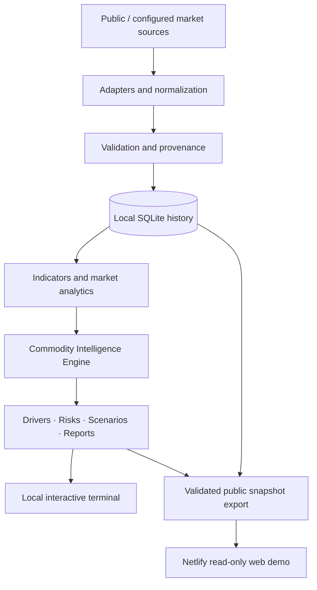

<div align="center">

# Commodity Intelligence Platform (CIT)

### A data-driven intelligence terminal for interconnected commodity markets.

Track market indicators, explore price history, examine supply–demand signals, and turn fragmented information into structured, traceable market research.

[**Launch the Interactive Dashboard**](https://commodity-intelligence-cit.netlify.app/) · [Explore the Architecture](#system-architecture) · [Run Locally](#run-locally)


</div>

---

## Live Product

**[Open CIT → Interactive Market Dashboard](https://commodity-intelligence-cit.netlify.app/)**

CIT is a working web application, not a static portfolio mockup. The hosted version uses the existing Next.js interface with **interactive charts, commodity navigation, indicator exploration, and saved market analysis**.

> **Public-demo boundary:** The hosted site reads a validated, read-only data snapshot. It does **not** run continuous cloud ingestion, database writes, administrator actions, or on-demand cloud AI. Some historical sulphur observations are **seeded/synthetic**, and some values are manual or stale. Always check the observation date and source before drawing conclusions.

## Dashboard Preview

[](https://commodity-intelligence-cit.netlify.app/)

*Actual CIT public-demo interface · Sulphur overview. Click the image to explore the deployed application. Displayed market figures are illustrative or historical where indicated by their provenance; they are not guaranteed live quotations.*

## What CIT Does

| Capability | What you can explore |
| --- | --- |
| **Multi-commodity workspace** | Configurable commodity views, including sulphur, crude oil, natural gas and macro indicators; additional industries can be registered without rebuilding the core UI. |
| **Price intelligence** | Interactive price series, history ranges, trend and momentum views, comparative benchmarks, spreads and import-cost analysis. |
| **Supply, demand & logistics** | Inventory, downstream utilization, shipping, import-cost and other commodity-specific indicators where data is available. |
| **Market drivers & risk** | Transparent market scoring, directional drivers, risk categories, conditional scenarios and rule-based outlooks. |
| **Provenance & quality** | Observation dates, source classification, freshness warnings, manual/derived status and anomaly checks. |
| **Alerts & research** | Rule-based monitoring and structured research reports in the full local application; previously saved outputs can be explored in the public demo. |

### The research workflow

**Collect → Validate → Normalize → Store → Analyze → Explain → Report**

The purpose is not simply to display commodity prices. CIT connects observations to their underlying market drivers, preserves the evidence behind conclusions, and makes data-quality limitations visible.

## System Architecture



The system intentionally separates **data collection**, **market calculations**, **intelligence logic**, and **presentation**. The public demo is a deployment mode of the existing application—not a separate mock dashboard.

<details>
<summary><strong>Engineering architecture & core modules</strong></summary>

| Layer | Implementation |
| --- | --- |
| Frontend | Next.js App Router, React, TypeScript, interactive chart and table components |
| Data access | `src/server/queries.ts` and typed repositories; UI components do not directly query SQL |
| Persistence | `node:sqlite`, additive migrations, observation history and report storage |
| Ingestion | Commodity-specific adapters, scheduled checks, normalization, source metadata and quality validation |
| Analytics | Changes, volatility, market score, price drivers, spreads, import parity and alerts |
| Intelligence | Driver, risk, confidence, scenario, forecast, research, explanation and market-memory modules |
| Public delivery | Sanitized JSON snapshot + read-only Next.js deployment on Netlify |

Key directories:

```text
src/
  app/                  Next.js commodity and system routes
  adapters/             Source-specific data integrations
  components/           Charts, tables and dashboard components
  config/commodities/   Per-commodity configuration
  intelligence/         Market intelligence engines
  lib/db/               SQLite, migrations and repositories
  lib/engines/          Indicators, scores, quality and alerts
  lib/public-data/      Snapshot export and read-only provider
  server/               Query and action boundaries
scripts/                Data export and developer utilities
public-data/            Validated public-demo snapshot
```

</details>

## Two Operating Modes

| | Full local terminal | Public interactive demo |
| --- | --- | --- |
| Web interface and interactive charts | Yes | Yes |
| Historical observations and saved reports | SQLite-backed | Snapshot-backed |
| Data ingestion and scheduling | Runs while local server is active | Disabled |
| Manual data entry and admin writes | Available locally | Disabled |
| Intelligence computation | Existing local engines | Existing exported results |
| Persistent writable database | Local SQLite | No |

This distinction is intentional: public visitors can explore the product without receiving privileged access to its data maintenance or execution workflows.

## Run Locally

**Requirements:** Node.js 22+ and npm.

```bash
# Full local application
npm install
npm run dev
# Open http://localhost:3000/sulphur/overview
```

```bash
# Export and test the read-only public demo using the local database
npm run export:public-demo
npm run build:public-demo
npm run start:public-demo
# Open http://localhost:3001
```

Useful checks:

```bash
npm run typecheck
npm run lint
npm run build
node scripts/inspect-db.mjs
```

The export command requires an existing local database and is not a substitute for automatic data collection in the hosted environment. Database files and secrets must not be committed to Git.

## Data Integrity & Limitations

- **Not a live-price feed:** The public build exposes a dated snapshot; the export timestamp is not the market observation timestamp.
- **Synthetic data:** Seeded sulphur history exists for development and demonstration and must not be interpreted as verified historical market assessments.
- **Source coverage varies:** Some adapters retrieve public data; certain physical commodity benchmarks and downstream indicators require manual updates or licensed access.
- **Model outputs are conditional:** Market scores, risk levels and scenario outlooks are research tools, not calibrated price probabilities or investment recommendations.
- **No privileged public operations:** Public visitors cannot write data, change admin settings, start ingestion jobs or invoke unrestricted cloud AI.

See [Public Demo Limitations](docs/PUBLIC_DEMO_LIMITATIONS.md), [Public Demo Deployment](docs/PUBLIC_DEMO_DEPLOYMENT.md), [Architecture](ARCHITECTURE.md) and [CIE Documentation](docs/CIE.md).

## Direction of Development

The next priorities are to expand **verified public market coverage**, automate safe snapshot refreshes, strengthen **industry-chain relationships**, and validate intelligence signals against reliable historical data—without compromising source provenance or reproducibility.

---

<div align="center">

**From fragmented commodity observations to explainable market intelligence.**

[**Explore CIT Live ↗**](https://commodity-intelligence-cit.netlify.app/)

</div>
